<h1 align=center>caelestia-plus</h1>

<p align=center>
A complete Hyprland desktop for Arch, built on <a href="https://github.com/caelestia-dots">Caelestia</a>:
the shell, the Hyprland config and the app configs, installed as packages.
</p>

> **A personal fork.** This is moimart's own desktop: Caelestia reshaped to one
> person's taste, with the features, defaults and look they wanted. It isn't
> a replacement for Caelestia or an attempt to compete with it, and it
> follows upstream rather than leading it. If you want Caelestia as its
> authors intend it, use [caelestia-dots](https://github.com/caelestia-dots).
> If this particular taste suits you, you're welcome to it.

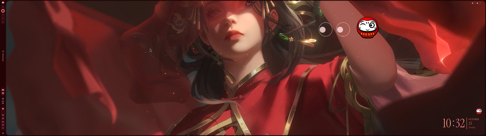

The shell is [moimart's fork of Caelestia's](shell/README.md). Around it: a
Hyprland config in Lua, and configs for fish, kitty, foot, ghostty, btop and
friends. Everything installs as pacman packages, and nothing in your home
folder is overwritten: the packages ship defaults, and your own files only
hold your changes.

## What's in it

### Window cards

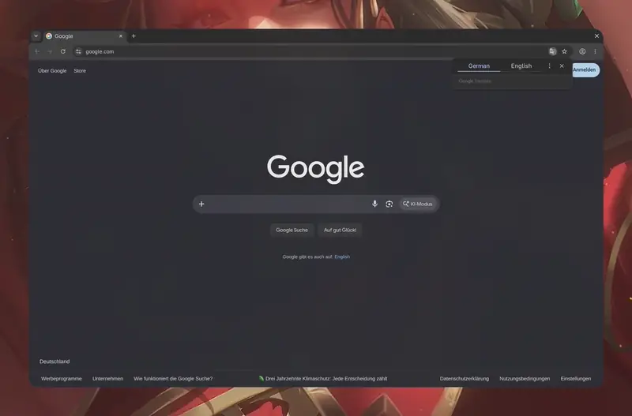

Pair two windows into one card and flip it over in 3D to show the other:
**Super+Alt+Tab** pairs (the focused window is the front; pick the back),
**Super+Tab** flips, **Super+Shift+Tab** splits them again. No Hyprland plugin:
a card is a locked window group, and the shell draws the turn with real
perspective, then hands back to the live window.

### Plugins: desktop widgets

Upstream's empty plugin page made real, starting with widgets that live on the
desktop, above the wallpaper:

- **Eyes**, like xeyes but quiet: three abstract styles (orbit, almond, dots)
  that follow your pointer, blink, and half-close when it rests.
- **Daruma**: the winking daruma, its painted eye following the pointer. It
  winks now and then, and shuts both eyes when the pointer is still.
- **The editor** (**Super+Ctrl+W**): drag widgets to move them, drag a corner
  to resize, add more from the palette. Each widget's settings are a form in
  Settings → Plugins.
- **Home Assistant widgets**: switches, buttons, sensors, cameras and
  dashboard cards ([below](#home-assistant)).
- **Your own**: a widget is a folder with a small manifest and a QML file, in
  `~/.config/caelestia/plugins/widgets/`. [PLUGINS.md](shell/PLUGINS.md)
  explains how, and [`examples/widgets/clock`](shell/examples/widgets/clock) is
  a working template.

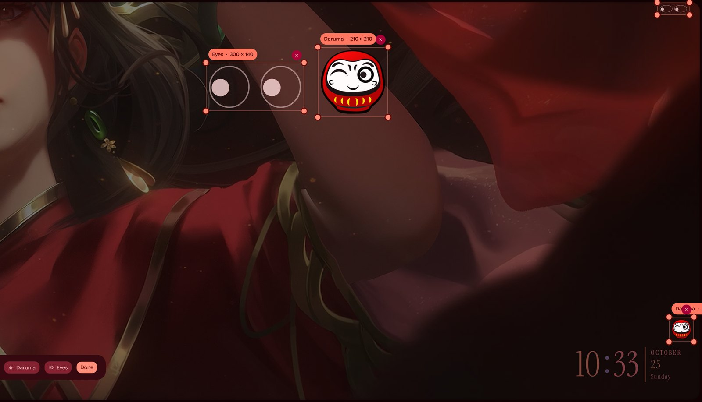

### Camera

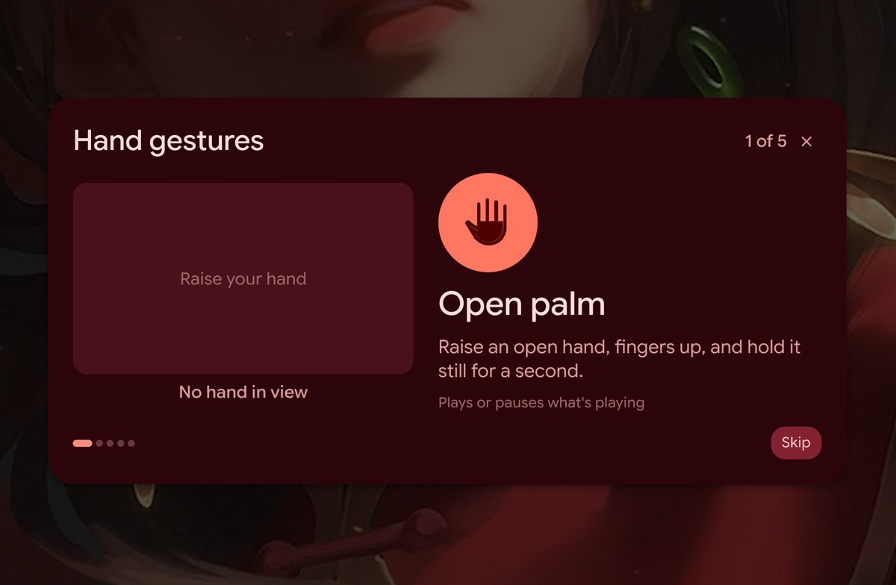

One small Rust daemon, `caelestia-camerad`, is the only thing that touches the
webcam. It reads frames through PipeWire, and only while a feature needs one,
so the camera and its light are off the rest of the time.

- **Presence**: while you're idle, it checks whether you're still at the desk.
  Reading or watching without touching anything? The screen stays on. Gone?
  It locks. Back? The screen wakes and face unlock starts.
- **Face unlock**, with [howdy](https://github.com/boltgolt/howdy), through the
  lock screen. Tries count in a row, so failed ones overnight don't lock you
  out in the morning.
- **Hand gestures** (**Super+Alt+G**): an open palm plays or pauses, swipes
  skip tracks, thumbs up and down run whatever you assign. A guided tutorial,
  with a live view of your hand, teaches them the first time.
- **The camera panel** (**Super+Alt+C**): a mirror to check yourself before a
  call; zoom, pan, tilt, focus, white balance and image controls; saved
  presets; and **video recording** to `~/Videos/Camera`, with sound from the
  camera's microphone.
- **Who's using it**: a camera icon in the bar turns red while any app has the
  camera, and its popout says which.
- **Unlock-attempt photos**: after three wrong passwords, a photo of whoever is
  at the keyboard, shown to you once you unlock.
- **Light sensor**: the room's light can set your monitor's brightness and
  switch between light and dark.
- **It gives way**: apps sharing the camera through PipeWire (Chrome with its
  PipeWire camera flag, Firefox, OBS) run alongside it at full speed; apps
  that open the camera directly make the daemon let go at once.

Faces come from YuNet and gestures from MediaPipe's palm and hand models, on
ONNX Runtime.

### Emoji picker

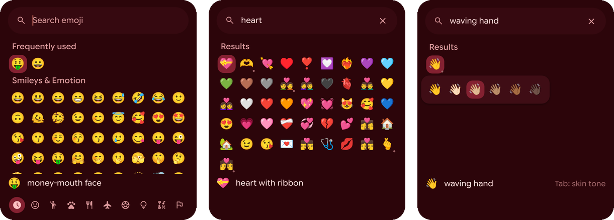

**Ctrl+Super+Space**, like Ctrl+Cmd+Space on a Mac, opens it next to your
pointer:

- **Search as you type**, by name or keyword: "lol" finds 😂, "heart" finds every heart.
- **Frequently used** first, and the categories along the bottom.
- **Skin tones**: right-click, or press Tab, on an emoji with a dot under it;
  it remembers your choice for that emoji.
- **Into any app**: pick one and it lands in what you were typing in. Apps get
  it pasted (Chrome and other Chromium apps garble emoji typed through a
  virtual keyboard), terminals get it typed, and your clipboard is put back.

### Displays

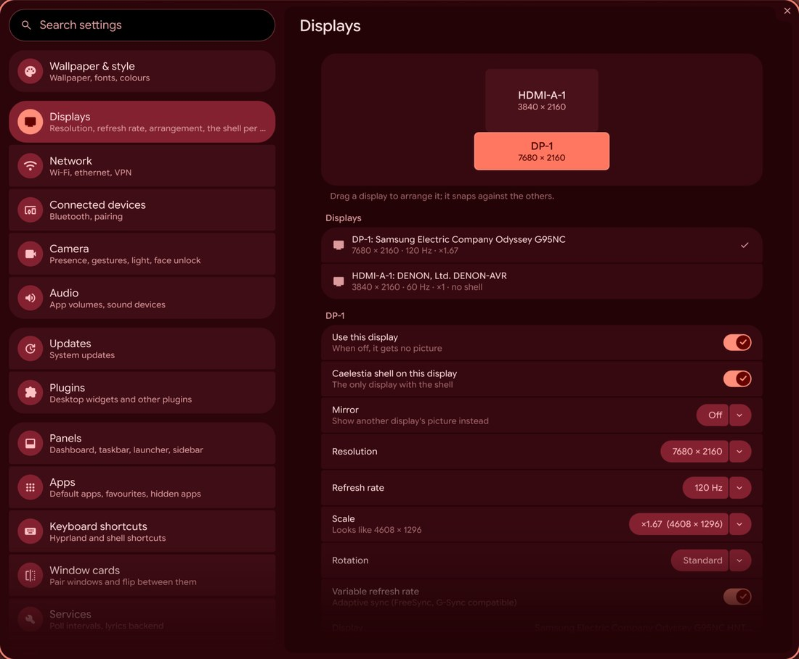

Settings → Displays, like macOS's: drag the displays into place (near an edge
they snap flush; further away they stay where you drop them), pick a resolution, refresh rate, scale and rotation, turn
VRR and mirroring on or off, and choose which displays get the shell. A
change that could leave a screen black asks "Keep these display settings?"
on every screen, and undoes itself after 15 seconds if you can't answer.
What you change is saved on top of your config, per display, keeping its
10-bit or HDR colour; Reset hands a display back to your config.

### The right bar

<table>
<tr>
<td width="45%" valign="top">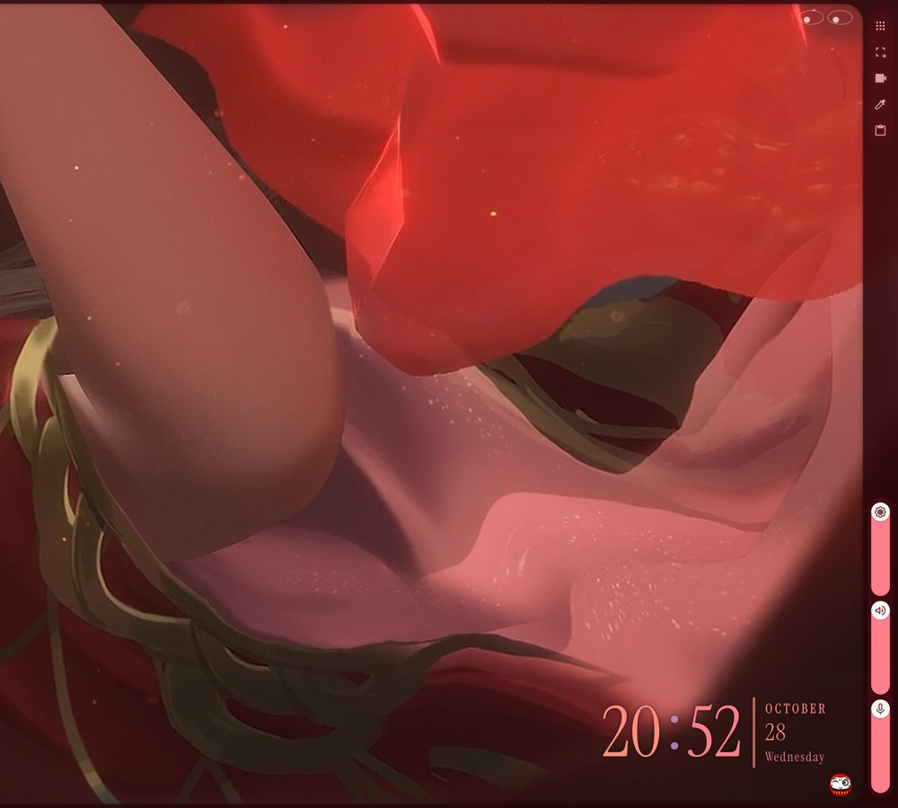</td>
<td width="55%" valign="top">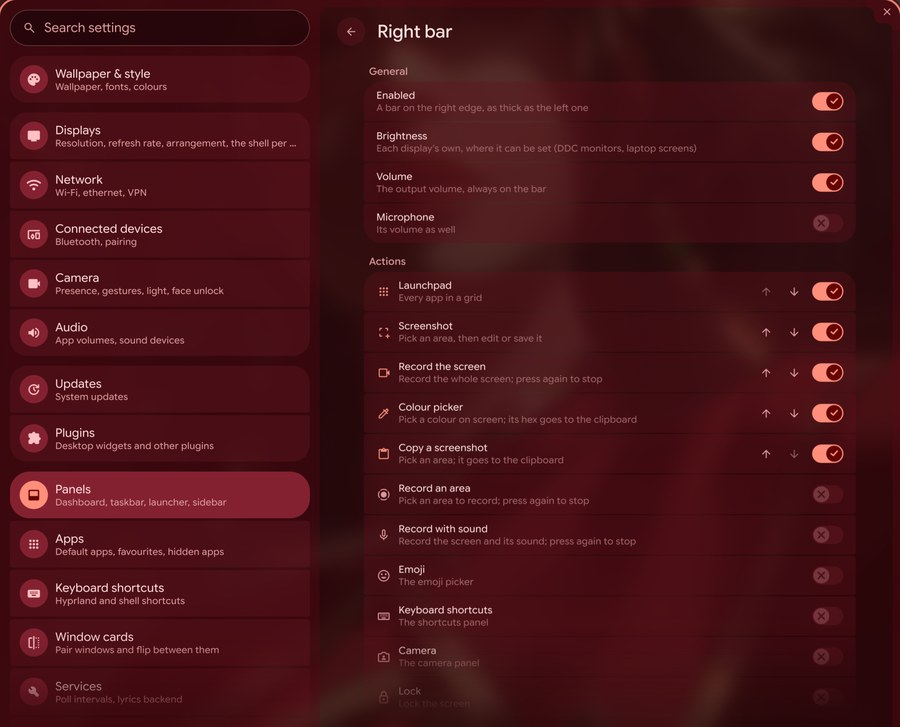</td>
</tr>
</table>

Settings → Panels → Right bar adds a second bar on the right edge, as thick as
the left one:

- **Brightness and volume, always there**: each display's own brightness
  (where it can be set), the volume, and the microphone if you like. The pop-up
  volume panel stays away while the bar shows them.
- **Action buttons**, in the order you choose: screenshots, recording an area
  or the screen (the button shows the time while it records), the colour
  picker, Launchpad, emoji and more.
- **Your own actions**: a folder with an `action.json` that runs a command, a
  shell line or any of the shell's IPC functions ([PLUGINS.md](shell/PLUGINS.md)).

### Home Assistant

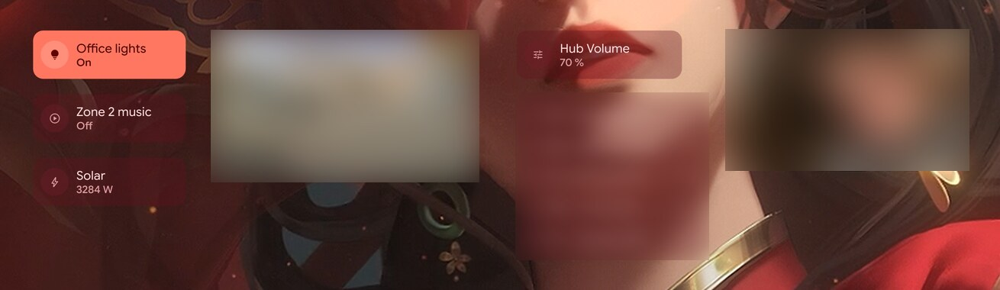

One place for your Home Assistant, as many instances as you have (a home and a
holiday flat, say): Settings → Home Assistant takes each one's URL and a
long-lived access token, kept in its own file readable only by you. The shell
keeps one live WebSocket to each, so everything below updates the moment an
entity changes.

- **Desktop widgets**: a switch or light (tap to toggle), a button (press,
  run a script or scene), an entity's state, a camera, and any card from your
  dashboards, drawn natively (tiles, entities, glance, gauges, pictures,
  stacks). Place them with the widget editor and pick what they show in
  Settings → Plugins.
- **Right bar shortcuts**: an entity or a dashboard card as a button on the
  right bar, lit while it's on (Settings → Panels → Right bar).
- **The lock screen**: cameras, energy, entities and dashboard cards, which
  only show there (see below).

Each widget, shortcut and card says which instance it comes from, so two homes
with the same entity names don't clash.

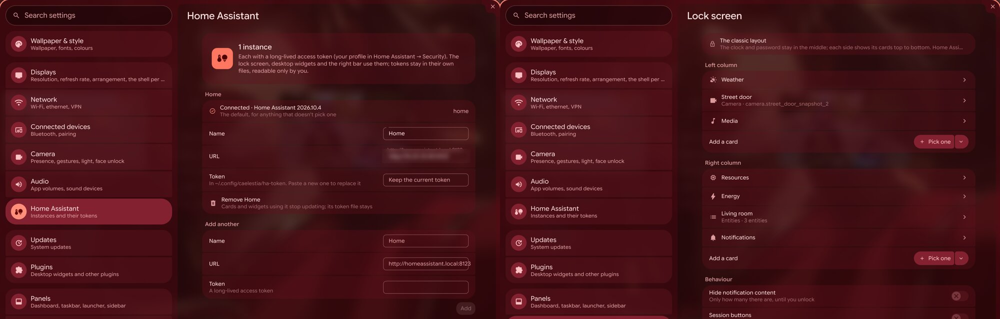

### System updates

Settings → Updates lists what's pending, checked every six hours without a
password, and **Update now** runs the upgrade with its progress (the step,
how far along, and the package manager's output if you want it). The password
goes to the system's polkit dialog, never to the shell; a kernel or core
library update suggests a restart. If an upgrade needs answers (a conflict, a
replaced package), **Update in a terminal** runs the same command there.

It uses pacman on Arch and its derivatives, tested on CachyOS. apt (Debian,
Ubuntu), dnf (Fedora) and zypper (openSUSE) are written as **reference
implementations**: they follow each tool's documentation but have never been
run, so expect to fix the odd detail. They're all in
[`services/SystemUpdates.qml`](shell/services/SystemUpdates.qml), one small
block each.

### In a virtual machine

A VM has no temperature sensors, so the CPU temperature (the dashboard, the
lock screen) read 0. Settings → Services → Host temperature shows the host's
instead, read from either:

- **The VM's host, over vsock**: QEMU's direct channel between a host and
  its VMs, with no network and no keys, and nothing anyone on the LAN can
  reach. Run [`host-sensors-vsock-setup.sh`](shell/assets/host-sensors-vsock-setup.sh)
  on the host once (`ssh root@host sh -s <vmid> < host-sensors-vsock-setup.sh`
  on Proxmox; it adds the VM's vsock device too), then stop and start the VM.
  The host serves the readings from a sandboxed, unprivileged service.
- **Any machine over ssh**: **Set up access** makes a key that the other
  machine only lets print its readings: no shell, no forwarding.

Machines with their own sensors keep using them.

### Right to left

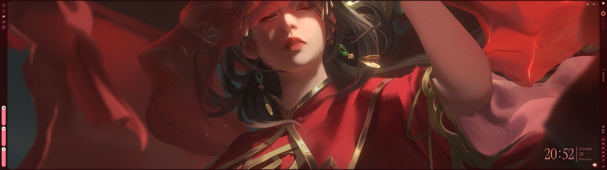

Settings → Panels → Right to left mirrors the whole layout: the bar and its
popouts on the right, the right bar on the left, and the sidebar,
notifications, session menu and volume popup coming in from the left. What's
inside each keeps its order.

### The window in the bar

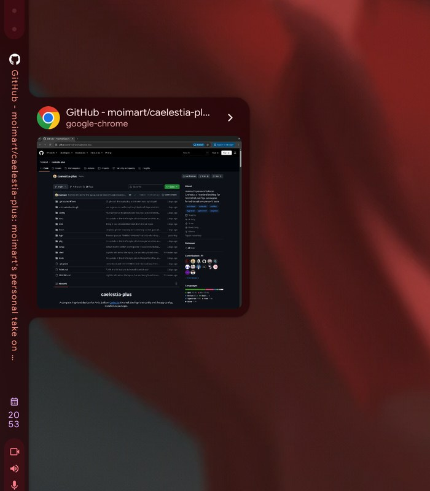

The bar's window title shows the window's own icon in colour, and for a browser
the favicon of the page you're on (read from the browser's own history, on
this machine only). Hover it, or **double-tap Super**, for a live preview of the
window; the pointer jumps onto it.

### Launchpad

<table>
<tr>
<td width="50%">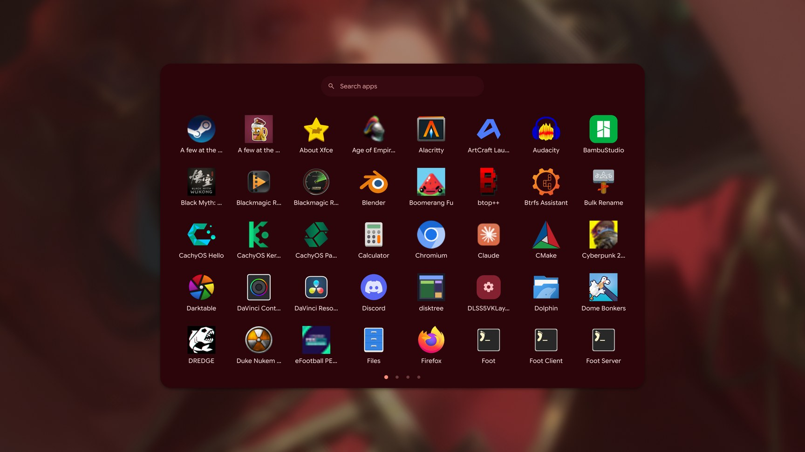</td>
<td width="50%">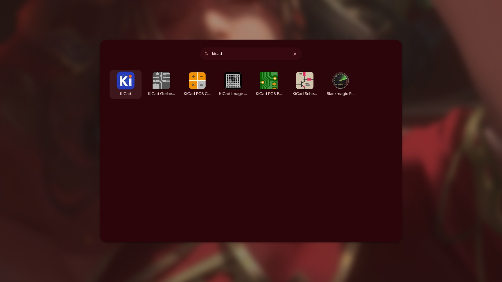</td>
</tr>
<tr>
<td align="center">Every app, A to Z, in pages</td>
<td align="center">Type, and it narrows to what you write</td>
</tr>
</table>

**Shift+Super+Space**, like Launchpad on a Mac: every app in a grid of pages in
the middle of the screen, over the desktop dimmed and blurred. Start typing
and it narrows to what you write; Enter or a click launches. The wheel, a drag
or the dots turn the pages.

<table>
<tr>
<td width="50%" valign="top">

### Video wallpapers

The desktop at the top is one. Any video in your wallpapers folder, picked
like an image and played through mpvpaper with hardware decoding, behind the
desktop clock and widgets. It pauses when it can't be seen, each monitor can
have its own, and the colour scheme follows it.

</td>
<td width="50%" valign="top">

### Keyboard shortcuts panel

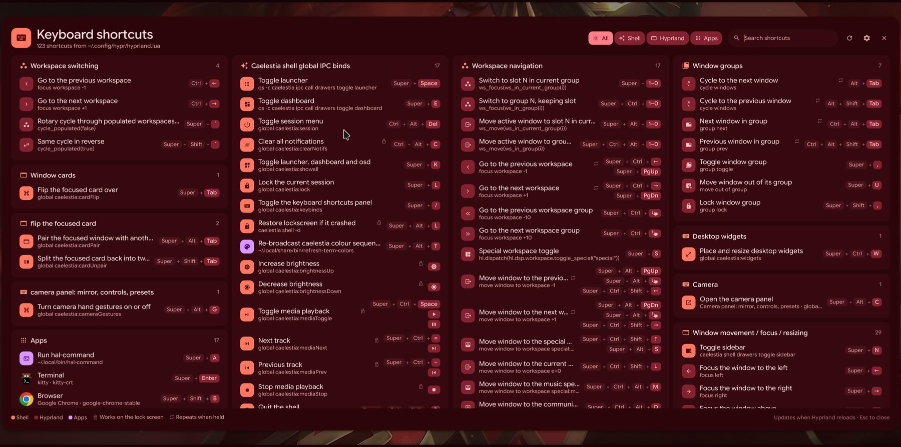

**Super+/** lists every shortcut you have, read from your own Hyprland config:
nothing is hardcoded. Searchable, grouped by your config's sections.

</td>
</tr>
<tr>
<td valign="top">

### Lock screen

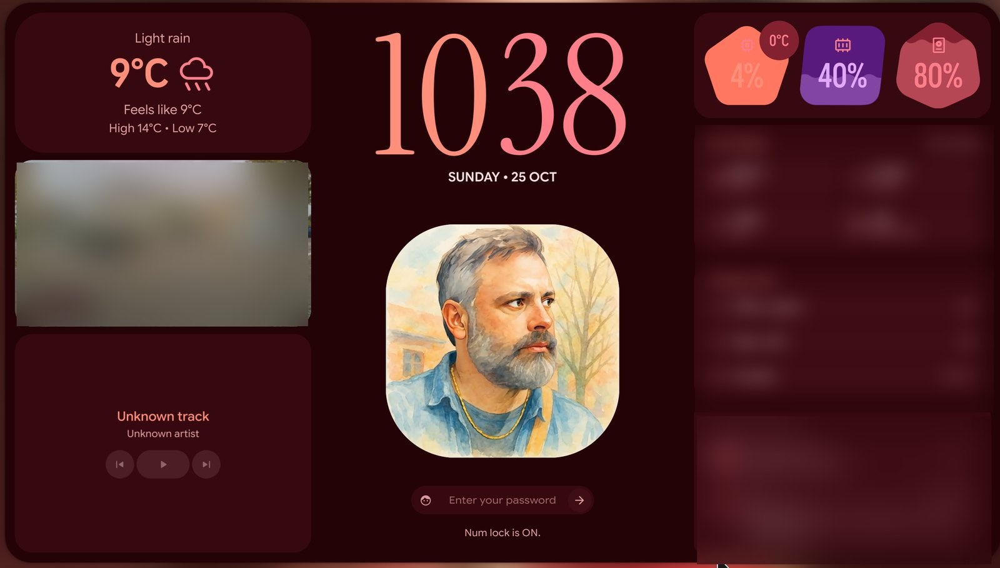

An animated profile picture, face unlock, and the cards you choose in
Settings → Lock screen: weather, system, media, resources, notifications and
Home Assistant ones (a camera, energy, entities, a dashboard card), in either
column, in any order. They only show: nothing there can be pressed. Without
changes it's the layout it always had.

</td>
<td valign="top">

### The daruma

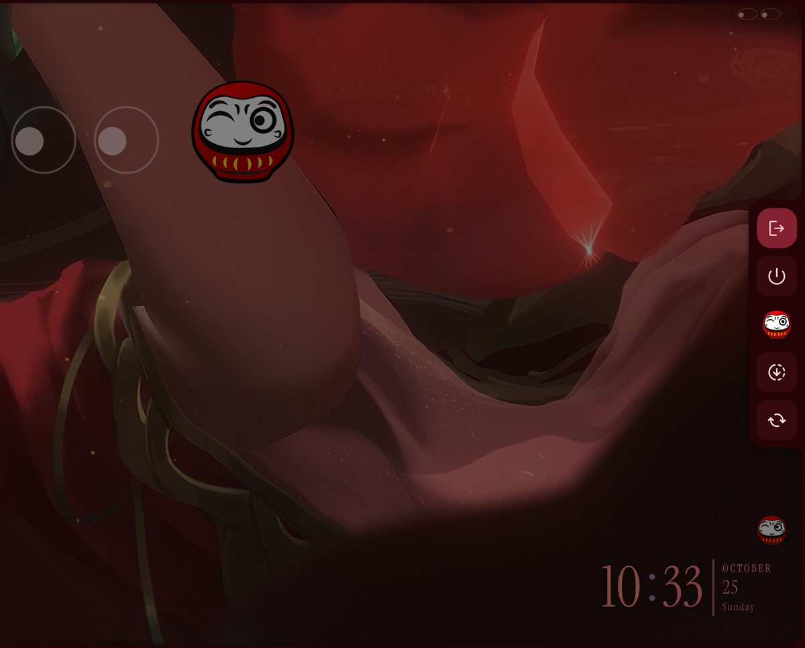

A winking daruma replaces Caelestia's mascots: the bar logo, the session
menu, and the media card while music plays.

</td>
</tr>
<tr>
<td colspan="2" valign="top">

### Settings for all of it

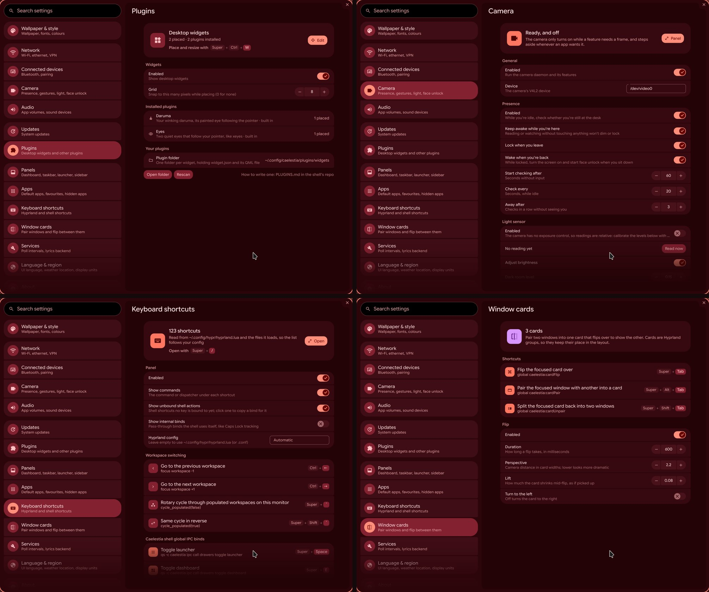

Each feature has its page in Settings, next to upstream's, and everything is
reachable from scripts (`caelestia shell <target> <function>`) and from AI
agents through an MCP server.

</td>
</tr>
</table>

### Talk to your desktop: the MCP server

An MCP server lets AI agents like Claude Code see and drive the desktop:
screenshots, wallpapers and colours, any setting, the displays, media, the
shortcuts, window cards, widgets, emoji and the camera (deliberately without a way to take
photos). 30 tools, set up with one line:

```sh
claude mcp add --scope user caelestia -- caelestia-mcp
```

Then ask things like "put a video wallpaper on my left monitor", "pair Chrome
and Steam into a card" or "is anything using my camera?". Every tool, with
examples: [docs/mcp](docs/mcp).

Around the shell, from the Hyprland config and app configs:

- **Window groups as tabs** in the shell's style: pills in its font, the
  focused one in the accent colour.

  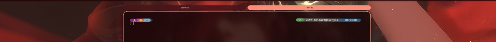

- **Super+Shift+Enter**: a floating terminal right at your pointer, kept on screen.
- **Super+both Shifts+Enter**: the same terminal shows the command on your
  clipboard, runs it when you press Enter (any other key cancels), and closes
  when it ends.
- **Super+both Shifts+F**: a floating file manager (Nautilus) at your pointer.
- **Browser sign-in popups and extension windows float at the pointer** (a
  password manager saving a passkey, say), at the size they asked for, instead
  of opening as full tiled windows.
- **kitty with a CRT shader**, phase-locked to the wall clock so every window
  flickers in sync (`kitty-crt`).
- fish with starship, eza and handy git abbreviations; foot and ghostty
  (with an amber CRT shader) as alternatives.
- A download sorter and AppImage launcher entries, as user services.

The full tour, with every shortcut: [the shell's README](shell/README.md).

## Install

On Arch (or CachyOS, EndeavourOS...) with a user account:

```sh
# Trust the signing key and add the repo
curl -sL https://moimart.github.io/caelestia-plus-packages/caelestia-plus.asc | sudo pacman-key --add -
sudo pacman-key --lsign-key BC40964C5AA4206E09F6148BD849D193EECADBBB
printf '\n[caelestia-plus]\nSigLevel = Required\nServer = https://moimart.github.io/caelestia-plus-packages/$arch\n' \
    | sudo tee -a /etc/pacman.conf

# Install, then set up your user
sudo pacman -Syu caelestia-plus
caelestia-plus-setup
```

Log out, choose Hyprland (uwsm), and you're in. This is a fresh install,
seconds after setup (in a VM, so no video wallpaper):

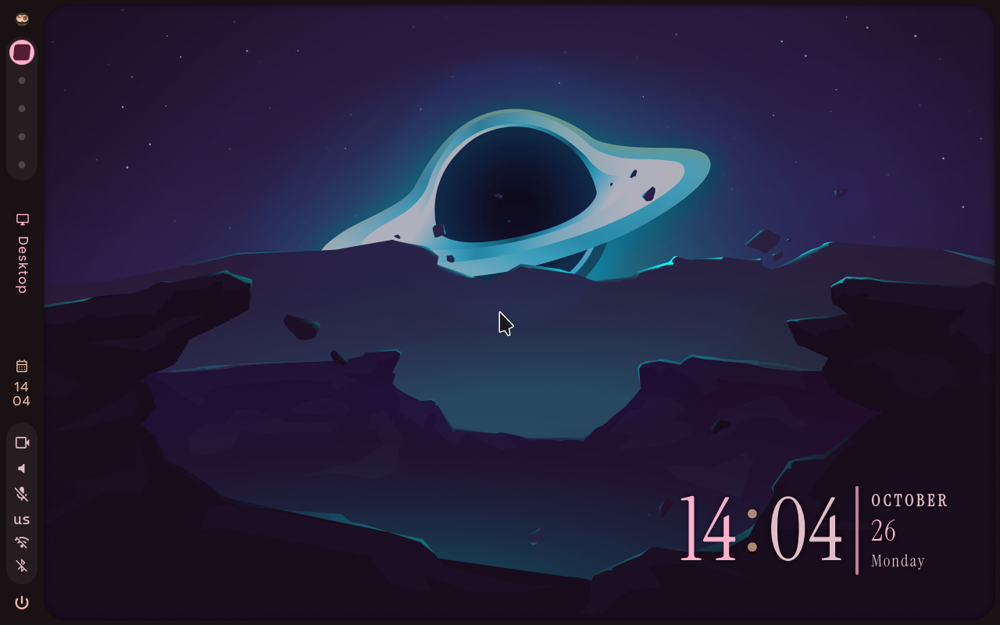

 The repo also carries the
AUR packages the shell needs (Quickshell, the Caelestia CLI, ...), built
together so they always match.

### Or build it yourself

The same packages, from source, without trusting the binary repo:

```sh
git clone https://github.com/moimart/caelestia-plus.git
cd caelestia-plus/pkg
makepkg -si          # builds the commit you have checked out
caelestia-plus-setup
```

This needs the AUR packages the shell depends on (`quickshell-git`,
`caelestia-cli`, `libcava`, `app2unit`, `ttf-rubik-vf`) from your AUR helper
first. An AUR recipe, [`caelestia-plus-git`](aur/caelestia-plus-git), is
ready for when AUR registration reopens.

## Make it yours

Settings stack in layers, each overriding the one before:

1. **The defaults**, from the packages (`/usr/share/caelestia-plus`,
   `/etc/xdg/caelestia`).
2. **Your personal layer**: what's yours on every machine (your face, your
   Home Assistant cards, your own binds).
3. **A host profile**: what belongs to one machine (monitors, scaling).
   Settings → Displays saves on top of it, in `~/.config/caelestia/displays.lua`.
4. **Your files in `~/.config`**: `~/.config/hypr/hyprland.lua` loads the
   defaults and then your changes; `~/.config/caelestia/shell.json` holds
   only the settings you changed in the shell.

Layers 2 and 3 live in `~/.config/caelestia-plus/`, ideally your own private
git repo: `caelestia-plus-setup --overlay <git URL>` clones it.
[`hosts/README.md`](hosts/README.md) shows how they look, and
[`hosts/example`](hosts/example) is a starting point.

## What's here

| Folder | What |
| --- | --- |
| [`shell/`](shell) | The Quickshell shell, its C++ plugin and the camera daemon (fork of [caelestia-dots/shell](https://github.com/caelestia-dots/shell)) |
| [`hypr/`](hypr) | The Hyprland config, in Lua |
| [`dots/`](dots) | App configs and scripts (fork of [caelestia-dots/caelestia](https://github.com/caelestia-dots/caelestia)) |
| [`config/`](config) | The shell's default settings and art, fonts, the download sorter |
| [`hosts/`](hosts) | How host profiles and the personal layer work |
| [`setup/`](setup) | `caelestia-plus-setup` and the files it creates |
| [`pkg/`](pkg) | The PKGBUILD for all the packages |
| [`tools/`](tools) | Development ([`dev.sh`](tools/dev.sh), see [DEVELOPMENT.md](docs/DEVELOPMENT.md)), a fresh install in a VM, comparing Hyprland configs |

CI builds, signs and publishes the packages to
[caelestia-plus-packages](https://github.com/moimart/caelestia-plus-packages)
on every push. To work on it: [DEVELOPMENT.md](docs/DEVELOPMENT.md).
[PLAN.md](PLAN.md) has the design and how it came together.

## Credits

[Caelestia](https://github.com/caelestia-dots) by soramane and its
contributors, on [Quickshell](https://quickshell.outfoxxed.me) and
[Hyprland](https://hypr.land).
