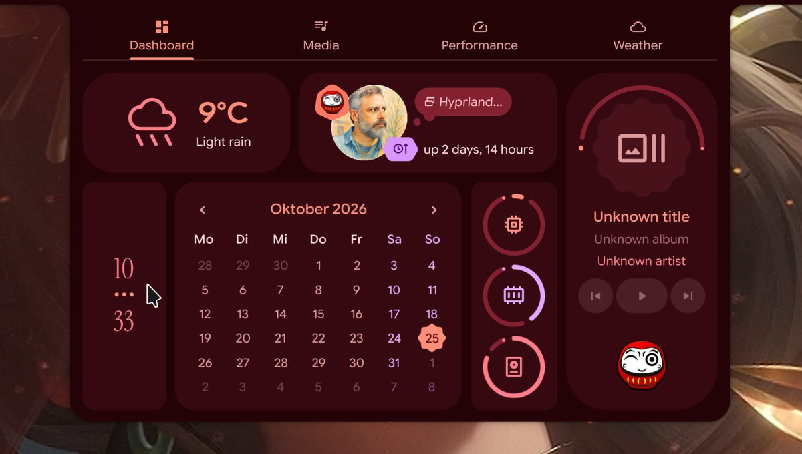

<h1 align=center>caelestia-shell · moimart</h1>

<p align=center>
A personal fork of <a href="https://github.com/caelestia-dots/shell">Caelestia</a>, the Quickshell desktop shell for Hyprland,
<br>with video wallpapers, desktop widgets, window cards, a camera that knows when you're there, and more.
</p>


Everything upstream Caelestia does still works; this fork adds to it and keeps
merging upstream now and then. For the original shell, its components and its
install guide, see [docs/UPSTREAM.md](docs/UPSTREAM.md). How the fork is built,
developed and kept in sync is in [FORK.md](FORK.md).

## Contents

- [Video wallpapers](#video-wallpapers)
- [Desktop widgets and plugins](#desktop-widgets-and-plugins)
- [Keyboard shortcuts panel](#keyboard-shortcuts-panel)
- [Displays](#displays)
- [The right bar](#the-right-bar)
- [Launchpad](#launchpad)
- [Emoji picker](#emoji-picker)
- [Window cards](#window-cards)
- [Camera](#camera)
- [Lock screen](#lock-screen)
- [The daruma](#the-daruma)
- [Settings](#settings)
- [Control from scripts and agents](#control-from-scripts-and-agents)
- [Shortcuts](#shortcuts)
- [Install](#install)

## Video wallpapers

Any video in your wallpapers folder can be the wallpaper, picked from the
launcher like an image. It plays through [mpvpaper](https://github.com/GhostNaN/mpvpaper)
with hardware decoding (an 8K HEVC loop costs about 6% CPU, against 25% through Qt),
and it hands over seamlessly: a poster frame shows first, then the video takes
over at the same moment, with the desktop clock and widgets drawn on top.

- Each monitor can have its own wallpaper, image or video (Shift+Enter in the
  launcher sets it for that monitor only).
- Playback pauses when it can't be seen: while locked, in game mode, behind a
  fullscreen window, or with the utilities panel's pause switch.
- The colour scheme follows the wallpaper, as for images.

## Desktop widgets and plugins


Upstream's empty plugin page is now a real plugin system, starting with
desktop widgets. **Super+Ctrl+W** opens the editor on every monitor: drag a
widget to move it, drag a corner to resize it, add more from the palette.

- **Eyes**: two quiet eyes that follow your pointer, like xeyes, in three
  abstract styles (orbit, almond, dots). They blink, and half-close when the
  pointer rests.
- **Daruma**: the winking daruma, its painted eye following the pointer.

Widgets are a folder with a small manifest and a QML file; drop your own in
`~/.config/caelestia/plugins/widgets/`. [PLUGINS.md](PLUGINS.md) explains how to
write one, and `examples/widgets/clock` is a working template.

## Keyboard shortcuts panel


**Super+/** shows every shortcut you have, read from your own Hyprland config;
nothing is hardcoded. It follows `hyprland.lua` and the modules it loads (or
`hyprland.conf`), works out what each bind does from its dispatcher, command,
app or your own comments, groups them by your config's sections, and
refreshes whenever Hyprland reloads. Search, filter by who handles a shortcut
(the shell, Hyprland or an app), and see the shell actions still waiting for a key.

## Displays


Settings → Displays, like macOS's:

- **Arrangement**: drag a display; an outline shows where it lands. Near
  another's edge it snaps flush (edges and centres line up when close); further
  away it stays where you drop it, and the page warns that the pointer can't
  get there. It never overlaps one. The canvas grows with the layout, so more
  displays just get smaller.
- **Resolution, refresh rate, scale and rotation**, from what the display
  reports. Scales are the ones that divide its resolution into whole pixels,
  with the size things look like.
- **Variable refresh rate**, **mirroring**, and turning a display **off**
  (never the last one).
- **The shell per display**: the bar, wallpaper, widgets and panels on it or
  not, for a TV or a capture display (never off on the last one).
- **Keep these display settings?** A resolution, refresh, scale, rotation,
  mirror or on/off change asks on every screen, and undoes itself after
  15 seconds if nobody answers.
- Changes apply at once and are saved to `~/.config/caelestia/displays.lua`,
  which the Hyprland config loads after the host profile: each display you
  change gets its mode, position, scale and rotation (keeping 10-bit or HDR
  colour), and moving one saves where they all are, so nothing shifts on its
  own. "Reset" hands a display back to your config. Also over IPC (`caelestia shell displays list`) and the MCP
  server (`displays`).

## The right bar

 

Settings → Panels → Right bar: a second bar on the right edge, as thick as the
left one, drawn by the same frame (windows keep clear of it; the sidebar,
volume popup and session menu attach at its inner edge, and hovering that edge
opens them as the screen edge did).

- **Brightness and volume**, always there: that display's own brightness
  (DDC monitors, laptop screens; each display's bar controls its own), the
  output volume, and the microphone if you turn it on. Drag or scroll. The
  pop-up volume panel stays away while the bar shows the volume (it comes back
  over a fullscreen window, where the bar hides).
- **Action buttons**, in the order you choose: Screenshot (edit it) or Copy a
  screenshot, Record an area / the screen / with sound (the button turns into
  stop, with the time), Colour picker, Launchpad, Emoji, Keyboard shortcuts,
  Camera, Lock.
- **Your own actions**: a folder in `~/.config/caelestia/plugins/actions/`
  with an `action.json` that runs a command, a shell line or an IPC function;
  see [PLUGINS.md](PLUGINS.md#action-plugins) and
  [`examples/actions/downloads`](examples/actions/downloads). From scripts:
  `caelestia shell barActions list` and `caelestia shell barActions run <id>`.


**Right to left** (Settings → Panels, `general.rightToLeft`) mirrors the
layout: the bar and its popouts on the right, the right bar on the left, the
sidebar, notifications, session menu, volume popup and toasts from the left
edge, and the reserved space following. Contents keep their
order (it's the panels that swap, not the text direction).

## Launchpad


**Shift+Super+Space** opens every app in a grid in the middle of the screen,
like Launchpad on a Mac, over the desktop dimmed and blurred:

- **Type to filter**: the grid narrows to what you write, best match first;
  Enter launches it.

  

- **A to Z**, in pages: the wheel, a drag, Page Up/Down or the dots turn them.
- **Arrows** move the selection, across pages too; Escape clears the search,
  then closes.
- It only launches apps. The same apps as the launcher (Super+Space): its
  hidden apps and fuzzy search setting apply.

## Emoji picker


**Ctrl+Super+Space** opens an emoji picker next to the pointer, like
Ctrl+Cmd+Space on a Mac. Pick one and it lands in the text box you were
typing in, in Chrome, Discord, a terminal or anywhere else.

- **Search as you type**, by name or keyword: "lol" finds 😂, "heart" finds
  every heart. Arrows and Enter, or a click, pick one; Esc closes.
- **Frequently used** emoji come first; the categories run along the bottom.
- **Skin tones**: emoji with a dot under them come in five. Right-click one, or
  press Tab, and pick; it remembers your choice for that emoji.
- **Into any app**: terminals get the emoji typed; other apps get it pasted,
  since Chrome and other Chromium-based apps garble emoji typed through a
  virtual keyboard. Whatever you had copied is put back afterwards.
- All of Unicode's emoji, with CLDR's keywords; also `>Emoji` in the launcher.

## Window cards


Pair two windows into one card and flip it over, in 3D, to show the other
([video](docs/screenshots/cards.mp4)).
**Super+Alt+Tab** makes the focused window a card's front and lets you pick the
back; **Super+Tab** flips; **Super+Shift+Tab** splits it back into two windows.

No Hyprland plugin is involved: the side not showing waits on a special
workspace of its own (never shown), and a flip swaps the two windows, so the
other takes exactly its place. A card is an ordinary window otherwise, focus
border included. The shell draws the flip with real perspective, then hands
back to the live window.

## Camera

One small Rust daemon, `caelestia-camerad`, is the only thing that touches the
webcam. It reads frames through PipeWire, and only while a feature needs one,
so the camera and its light are off the rest of the time. Apps that read the
camera through PipeWire (Chrome with `chrome://flags/#enable-webrtc-pipewire-camera`,
Firefox, OBS's PipeWire source) share it with the daemon at their normal
latency, since the daemon is never in their video path. Apps that open the
camera directly make the daemon let go at once and stay off while they're
interested; with gestures on, their very first attempt can still find the
camera busy, so turn that Chrome flag on.

- **In use**: a red camera icon in the bar while any other app has the camera, with who.
- **Camera panel** (**Super+Alt+C**): a mirror to check yourself before a call,
  zoom, pan, tilt, focus, white balance and image controls, and saved presets.
  Its record button saves video clips, with sound, to `~/Videos/Camera`.
- **Presence**: while you're idle it checks whether you're still at the desk.
  If you are (reading, watching), the screen won't dim or lock; if you've left,
  it locks; when you sit back down, the screen wakes and face unlock starts.
- **Gestures** (**Super+Alt+G**): an open palm plays or pauses, swipes skip
  tracks, thumbs up and down are yours to assign (any command). A guided
  tutorial with a live view of your hand teaches them the first time:

  

- **Face unlock** with [howdy](https://github.com/boltgolt/howdy), and a photo
  after repeated wrong passwords on the lock screen, shown when you unlock.
- **Light sensor**: the room's light can set monitor brightness and the light
  or dark scheme.

Faces come from YuNet and gestures from MediaPipe's palm and hand models
(both from [opencv_zoo](https://github.com/opencv/opencv_zoo)), running on ONNX Runtime.

## Lock screen


- **Home Assistant** cards, read-only: a camera feed, energy (solar, home, grid,
  battery) and the entities you choose, configured in `lock-ha.json`.
- An **animated profile picture**: the face can be a video, here a painted
  portrait that moves. It plays only while it's on screen.
- The clock in **Instrument Serif**, like the desktop clock.
- Face unlock, and presence waking the screen when you come back (see Camera).

## The daruma

 

A winking daruma replaces Caelestia's mascots: it's the bar logo, it winks in
the session menu, and it turns on its axis in the media card while music plays.
The artwork lives in my dotfiles and is set through the shell's own options
(`general.logo`, `paths.sessionGif`, `paths.mediaGif`); the fork shows image
logos in their own colours instead of tinting them.

## Settings


Each feature has its page in Settings (Nexus): Plugins, Camera, Keyboard
shortcuts and Window cards, next to upstream's. The settings window tiles like
a normal window, and `>Settings` and `>Shortcuts` in the launcher open things directly.

Smaller things along the way: apps and notifications without an icon get a tidy
tile in the scheme's colours instead of the checkerboard, and web apps (Chrome
PWAs) get their real icons in the bar. The bar's window title shows the window's
own icon in colour, and for a browser the favicon of the page you're on (from the
browser's own history, read on this machine only; private windows keep the
browser's icon).

## Control from scripts and agents

Everything is reachable over the shell's IPC, from the command line
(`caelestia shell <target> <function>`), for example:

```sh
caelestia shell keybinds toggle
caelestia shell emoji search heart
caelestia shell launchpad toggle
caelestia shell cards flip
caelestia shell widgets add eyes DP-1
caelestia shell camera toggleGestures
caelestia shell wallpaper setFor DP-1 ~/Videos/loop.mp4
```

An [MCP server](mcp/README.md) lets AI agents such as Claude Code drive the
shell: screenshots, wallpapers, colour schemes, settings, the lock screen,
media, panels, shortcuts, emoji, window cards, widgets and the camera (on purpose,
without a way to take photos).

## Shortcuts

| Keys | |
| --- | --- |
| Super+/ | Keyboard shortcuts panel |
| Super+Ctrl+W | Place and resize desktop widgets |
| Shift+Super+Space | Launchpad |
| Super, Super (double tap) | The focused window's preview, from the bar |
| Ctrl+Super+Space | Emoji picker |
| Super+Alt+Tab · Super+Tab · Super+Shift+Tab | Pair a window card · flip it · split it |
| Super+Alt+C | Camera panel |
| Super+Alt+G | Hand gestures on/off |

These are bound in the Hyprland config; the shell registers them as global
shortcuts (`caelestia:keybinds`, `caelestia:launchpad`, `caelestia:windowPreview`, `caelestia:emoji`, `caelestia:widgets`, `caelestia:cardPair`,
`caelestia:cardFlip`, `caelestia:cardUnpair`, `caelestia:camera`,
`caelestia:cameraGestures`), so you can bind them to anything.

## Install

The fork builds as an Arch package that replaces `caelestia-shell`:

```sh
git clone git@github.com:moimart/caelestia-shell.git
cd caelestia-shell/pkg
makepkg -si
```

Optional, for the extras:

```sh
sudo pacman -S mpvpaper ffmpeg      # video wallpapers
sudo pacman -S onnxruntime-cpu      # camera presence, gestures, light
paru -S howdy-git                   # face unlock
```

[FORK.md](FORK.md) covers developing (running a checkout next to the installed
shell), the camera setup in detail, and merging upstream.

## Credits

[Caelestia](https://github.com/caelestia-dots/shell) by soramane and its
contributors, on [Quickshell](https://quickshell.outfoxxed.me) and
[Hyprland](https://hypr.land). Camera models from
[opencv_zoo](https://github.com/opencv/opencv_zoo); the clock face is
[Instrument Serif](https://github.com/Instrument/instrument-serif).
